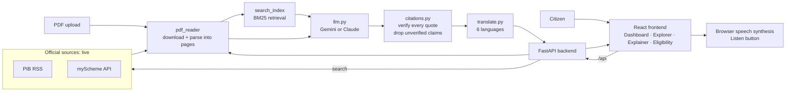

# NagrikAI: Civic Intelligence

Hackathon: Forge (Gen AI buildathon) · Theme 1: Civic Pulse, Digital Governance & Public Information
Problem: **Multilingual Policy, Rights & Scheme Explainer**

NagrikAI fetches real government documents, explains them in plain language in six Indian
languages, and links every statement to the exact page and clause it came from. Statements
the AI cannot prove from the document are removed.

## Features

- **Policy Explorer**: live search across official sources (PIB releases with a "Policy-related only" switch, myScheme), filters, beneficiary chips
- **Add a document**: paste an official link (.gov.in / .nic.in) or **upload a PDF**; uploads are labelled "not verified as official"
- **Policy Explainer**: original document beside a Simple / Detailed / Key Benefits explanation, with citations
- **Ask about this policy**: short documents are read whole by the AI, long ones are searched (query rewriting + BM25); every answer must quote the document, and refuses when the document does not contain it
- **Eligibility Checker**: criteria, required documents and application steps extracted from the policy, then matched to your details
- **How it works** panel and a device-only workspace (no login; history stays in your browser)
- **Languages**: English, Hindi, Bengali, Tamil, Telugu, Marathi · **Listen** button reads explanations aloud

## Architecture



More detail: [docs/architecture.md](docs/architecture.md).

```
frontend/   React (Vite)      what the user sees
backend/    FastAPI (Python)  fetches documents, calls the AI, verifies citations
data/       real downloaded documents and caches (created at runtime)
```

## Setup

You need **Node 18+** and **Python 3.10+**.

### 1. Keys
```bash
cp .env.example .env
# open .env and add GEMINI_API_KEY (free at https://aistudio.google.com/apikey)
```

### 2. Backend
```bash
cd backend
python -m venv .venv
source .venv/bin/activate        # Windows: .venv\Scripts\activate
pip install -r requirements.txt
python ../scripts/check_sources.py   # tests the live government sources
uvicorn main:app --reload --port 8000
```
Open http://localhost:8000/docs to try every endpoint.

### 3. Frontend (new terminal)
```bash
cd frontend
npm install
npm run dev
```
Open http://localhost:5173.

### Deploy (live URL): one service on Render
The backend also serves the built React app, so there is one URL and no CORS setup.
1. Push this repo to GitHub (`.env` is git-ignored, so your key stays private).
2. On render.com: New > Blueprint > pick the repo (uses `render.yaml`). Enter `GEMINI_API_KEY` when asked.
3. Open `https://<service>.onrender.com/api/health`, then the site root.
Free Render services sleep when idle: open the site a minute before any live demo.

### Tests
```bash
cd backend && pytest
```

## Data sources (no dummy data)

| Source | Status | Notes |
|---|---|---|
| PIB (pib.gov.in) | Works without a key | RSS feed of recent releases. Releases that look like policies are tagged and shown by default; untick "Policy-related only" to see all. These are announcements, not full policy documents |
| Uploaded PDF | Works without a key | Always works, even if a government site is down. Not verified as official |
| Pasted official link | Works without a key | Best source for real notifications, guidelines and draft policies |
| myScheme | Needs `MYSCHEME_API_KEY` | Undocumented API; run `check_sources.py` and adjust `sources/myscheme.py` if the response format differs |
| e-Gazette, India Code | Link-out only | Add a connector in `backend/sources/` (see `pib.py` as a template) |

If a source is down the app says so; it never fills the screen with made-up policies.

## Things to verify before the demo

1. `python scripts/check_sources.py` shows at least PIB returning policies.
2. Government sites with an incomplete certificate: `pip install -r requirements.txt` installs `truststore`, which uses your system certificates. If a link still fails, set `PDF_CA_BUNDLE` in `.env`.
3. The `GEMINI_MODEL` name in `.env` is currently valid (Google renames models). If the model is often busy, set `GEMINI_FALLBACK_MODEL` too.
4. Pick 2-3 policies, open each once so documents and explanations are cached (real data, saved locally), in case a government site is slow during judging.
5. Every team member can walk through: `routes/explain.py` -> `ai/citations.py` -> `ai/search_index.py`.

## Folder guide

```
backend/
  main.py              starts the server
  config.py            reads .env
  pdf_reader.py        document -> numbered pages
  routes/              API endpoints (policies, explain, ask, eligibility)
  sources/             government source connectors (+ registry.py combines them)
  ai/                  llm.py · prompts.py · search_index.py · citations.py · translate.py
  tests/               citation and retrieval tests
frontend/src/
  pages/               Dashboard, PolicyExplorer, PolicyExplainer, EligibilityChecker
  components/          Sidebar, Topbar, PolicyCard, CitationChip, ListenButton, ChatBox, ...
  api.js               every backend call
  translations.js      interface text in 6 languages
```

## PIB feed language
`PIB_RSS_URL` in `.env` chooses the feed. PIB's own feed page (https://www.pib.gov.in/ViewRss.aspx?reg=48&lang=1) says `lang=1` is English and `lang=2` is Hindi. Copy the Press Releases feed link from that page into `PIB_RSS_URL` (also on Render under Environment), then restart.

## Demo checklist
1. Open `/api/health` on the live site: build matches, `llm_configured` is true.
2. Paste one official link, upload one PDF, open both once so the explanations are cached.
3. Show: explanation with page/clause chips, the removed-unverifiable-points note, Listen, a question the document answers and one it does not (refusal), Eligibility check.
