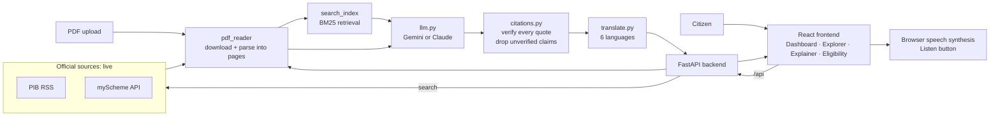

# NagrikAI architecture

## The anti-hallucination loop

1. The AI may only use the document text it is given.
2. For every point it must return an exact quote from that text.
3. `citations.py` searches the real document for the quote.
   Found: attach the true page and clause. Not found: the point is removed.
4. `/api/ask` refuses to answer when no verified citation exists.

## Folder map

| Folder | What lives there |
|---|---|
| `frontend/src/pages` | the 4 screens |
| `frontend/src/components` | reusable UI pieces |
| `backend/routes` | API endpoints the frontend calls |
| `backend/sources` | one connector per government source |
| `backend/ai` | LLM calls, prompts, retrieval, citations, translation |
| `data` | real documents downloaded at runtime + caches |
